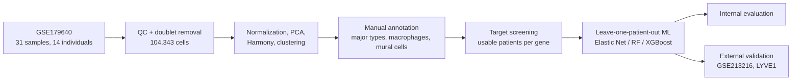

# Predicting LYVE1 and CCL19 Expression in Unseen Endometriosis Patients from Single-Cell RNA-seq

> **Research question:** Can machine learning predict the expression level of selected immune-regulatory genes
> (*LYVE1* in macrophages, *CCL19* in perivascular/mural cells) in cells from **patients that were never used for training**,
> using the expression of other genes?

**Short answer:** In held-out patients, the models ranked cells by target-gene expression clearly better than simple
baselines, and the *LYVE1* result was supported in an independent cohort. Accuracy is moderate, varies strongly between patients,
the number of patients is small, and all predictions are **associations, not causal mechanisms**.

---

## Table of Contents

1. [Key Results](#key-results)
2. [Study Design](#study-design)
3. [Data](#data)
4. [Methods](#methods)
5. [Detailed Results](#detailed-results)
6. [What Drives the Predictions](#what-drives-the-predictions)
7. [Limitations](#limitations)
8. [Repository Structure](#repository-structure)
9. [Getting Started](#getting-started)
10. [Reproducibility Notes](#reproducibility-notes)
11. [References](#references)

---

## Key Results

| | *LYVE1* (macrophages) | *CCL19* (mural cells) |
|---|---|---|
| Cells used | 4,762 | 2,537 |
| Test patients | 10 internal, 5 external | 7 internal, none external |
| Mean per-patient Spearman (Elastic Net) | **0.60** internal, **0.55** external | **0.57** internal |
| Simple baseline | 0.48 (subtype mean); 0.14 (technical metrics, external) | 0.11 (subtype mean) |
| ROC AUC, expressing vs. not (pooled test patients) | ~0.83-0.84 internal, 0.86 external | ~0.91-0.92 internal |
| Main caveat | Partly circular clusters; test patients selected for detectable *LYVE1* | Relies strongly on *CCL21*; only 7 patients |

> **Note on baselines:** the baseline type differs between rows (subtype mean vs. technical metrics only), so the gaps should
> not be compared across rows.

---

## Study Design



**Principles that guard against over-optimistic results**

- **Leave-one-patient-out (LOPO):** every test patient is completely absent from training.
- **Target gene removed** from the model inputs.
- **Feature selection on training cells only** (top 2,000 variable genes).
- **Inputs are log-normalized expression**, not the Harmony embedding (Harmony was used for clustering only).
- **Baselines** (subtype mean, cluster mean, technical metrics only) to check that the models learn more than cell type or cell quality.
- **External validation criteria fixed before looking at results:** Spearman positive and higher than the technical-only model in at least 4 of 5 patients.

---

## Data

| Dataset | Content | Use |
|---|---|---|
| [GSE179640](https://www.ncbi.nlm.nih.gov/geo/query/acc.cgi?acc=GSE179640) (Tan et al., 2022, *Nat Cell Biol*) | Single-cell biopsies of control, eutopic endometrium and ectopic lesions | Training and internal evaluation |
| [GSE213216](https://www.ncbi.nlm.nih.gov/geo/query/acc.cgi?acc=GSE213216) (Fonseca et al., 2023, *Nat Genet*) | 45 single-cell tissue samples from 19 patients; 16 samples from 14 patients screened | External validation (*LYVE1* only) |

**Samples used from GSE179640:** 31 samples from 14 individuals

| Tissue | Samples |
|---|---|
| Control | 3 |
| Eutopic endometrium (EuE) | 9 |
| Ectopic peritoneal lesion (EcP) | 8 |
| Adjacent peritoneal tissue (EcPA) | 7 (includes one technical replicate of patient E09) |
| Ectopic ovarian lesion (EcO) | 4 |

Four EOR samples were excluded: EOR01 and EOR03 had no detected *CCL19* or *LYVE1* cells; for EOR02 and EOR04 the genes were not
found by name and the cell numbers were unusual. The reason was not investigated.

> Raw data and large intermediate files are **not** tracked in this repository (see `.gitignore`). Download them from GEO as
> described in [Getting Started](#getting-started).

---

## Methods

### 1. Processing (R, Seurat)

- **QC per sample:** at least 500 genes, at least 1,000 UMIs, at most 100,000 UMIs, below 25% mitochondrial reads; genes detected in at least 3 cells.
  Cells: 140,433 before QC, 111,060 after.
- **Doublets** removed with scDblFinder (6,717 removed) → **104,343 cells**; **27,722 genes** shared by all samples.
- **Normalization** to the median UMI count, then log; 1,937 variable genes after removing mitochondrial, ribosomal, hemoglobin, cell-cycle and stress genes;
  30 principal components; Harmony on patient (clustering only); 23 clusters (resolution 0.3).

### 2. Annotation (manual, from marker DotPlots)

- Five major cell types: stromal, lymphocytes, epithelial, myeloid, endothelial (plus unassigned). *CCL19* and *LYVE1* were **not** used as markers.
- Myeloid cells re-clustered (14 clusters) → macrophages; stromal cells re-clustered (16 clusters) → mural cells.

### 3. Target screening

A patient is "usable" for a group if it has at least 50 cells and at least 10 expressing cells.
The ML uses the **broad groups** (all macrophages for *LYVE1*, all mural cells for *CCL19*) to reduce circularity with the target-defined clusters.

| Gene | Group | Cells | Expressing | Usable patients |
|---|---|---|---|---|
| *LYVE1* | All macrophages | 4,762 | 1,431 (30.1%) | 10 |
| *CCL19* | All mural cells | 2,537 | 495 (19.5%) | 7 |

### 4. Machine learning (Python, Google Colab)

- One regression model per target gene: **Elastic Net, Random Forest, XGBoost** (fixed settings).
- **Metrics:** Spearman (main), R², RMSE, MAE, bias, AUC (expressing vs. zero), Spearman among expressing cells.
- **Baselines:** subtype mean, cluster mean, technical metrics only (UMI count, genes detected, mitochondrial fraction).

### 5. External validation (*LYVE1*)

Macrophage-like cells (at least 2 of *C1QA, C1QB, C1QC, CD68, CD163, MS4A7* detected; *LYVE1, FOLR2, MRC1* not used) from GSE213216,
processed with the same QC, doublet removal and normalization. Models were applied **without retuning**.
A patient was tested if it had at least 10 *LYVE1*+ macrophage-like cells.

---

## Detailed Results

### Internal evaluation (leave-one-patient-out)

Mean of per-patient Spearman correlation (test patients only):

| Setting | Elastic Net | Random Forest | XGBoost | Baseline |
|---|---|---|---|---|
| *LYVE1*, 10 patients | 0.60 | 0.58 | 0.60 | 0.48 (subtype mean) |
| *LYVE1*, without the *LYVE1*-defined cluster, 9 patients | 0.38 | - | 0.37 | 0.04 (cluster mean) |
| *CCL19*, 7 patients | 0.57 | 0.56 | 0.55 | 0.11 (subtype mean) |

- The three models perform similarly; with few patients and no tuning, **no model is claimed to be better than another**.
- Models beat the subtype baseline in 8 of 10 *LYVE1* patients and in all 7 *CCL19* patients.
- Per-patient Spearman ranges from 0.32 to 0.86 (*LYVE1*) and from 0.23 to 0.79 (*CCL19*).

### External validation of *LYVE1* (GSE213216)

| Patient | Cells | *LYVE1*+ | Elastic Net | XGBoost | Technical only |
|---|---|---|---|---|---|
| X07 | 198 | 48 | 0.510 | 0.529 | 0.107 |
| X08 | 346 | 154 | 0.695 | 0.703 | 0.210 |
| X09 | 362 | 138 | 0.592 | 0.577 | 0.077 |
| X11 | 667 | 108 | 0.465 | 0.502 | 0.104 |
| X14 | 90 | 19 | 0.505 | 0.426 | 0.213 |
| **Mean** | | | **0.553** | **0.547** | **0.142** |

The pre-defined success criterion was met in **5 of 5 patients**. Performance was about 0.05 lower than internally, as expected for independent data.

### ROC and precision-recall analysis

ROC and precision-recall curves (expressing vs. not expressing, test patients pooled) are in `figures/` (figures 5 and 6).
Simple baselines are close to chance. The AUC is computed on all cells of the group, so part of it reflects membership of the
expression-rich subtype.

### Robustness checks

| Check | Result |
|---|---|
| *LYVE1* without the *LYVE1*-defined cluster | Elastic Net 0.381, XGBoost 0.371 vs. 0.037 (cluster-mean baseline); positive in every remaining cluster (0.29-0.55) |
| Technical metrics only, *LYVE1* | Pooled Spearman 0.158 (with genes: 0.584) |
| Technical metrics only, *CCL19* inside the perivascular cluster | Pooled Spearman 0.085 (with genes: 0.668) |
| *CCL19* without *CCL21* as input | Ranking changed little; absolute level got worse (R² 0.34 → 0.08) |
| Elastic Net with nested tuning | *LYVE1* 0.602, *CCL19* 0.564: no gain over defaults |

---

## What Drives the Predictions

Genes with a non-zero Elastic Net coefficient in every fold and with the same sign:

- **LYVE1 (59 genes):** positive, largest: *RNASE1, LILRB5, COLEC12, MARCO, AGFG1, EMB, CLEC10A, CYBB, FCGR2B, C1QC*; negative, largest: *APOE, GPNMB, ALCAM, LGALS1, IGSF6, HLA-DQA1*.
- **CCL19 (54 genes):** *CCL21* dominates (coefficient 0.568, about 3.5 times the next gene *CXCL12* at 0.160).

The folds overlap heavily, so this is weak evidence of stability, and a large coefficient indicates **association, not cause**.
The dependence on *CCL21* is consistent with the original study's report that perivascular *CCL19*+ cells also express *CCL21*.
The biological interpretation of the *LYVE1*-associated genes has not been checked against the literature.

---

## Limitations

1. **Few patients** (10 internal for *LYVE1*, 7 for *CCL19*, 5 external); per-patient performance varies widely.
2. **Test patients were selected** for detectable expression of the target gene, internally and externally.
3. **External validation covers *LYVE1* only**, mostly endometrioma samples, and one patient has only 90 cells. *CCL19* was not validated externally.
4. **Annotation was done on all patients before the train/test split.**
5. **Partial circularity:** the *LYVE1*- and *CCL19*-related clusters were partly shaped by the target genes. The analysis without the *LYVE1* cluster addresses this for *LYVE1* only.
6. Doublet removal differs from the original study (scDblFinder only); residual doublets are possible.
7. Four EOR samples were excluded without investigating the reason.
8. Random Forest and XGBoost were not tuned.
9. Hormonal treatment and cycle phase are unknown for the external samples.
10. **Association, not causation.**
11. The models rank cells well but estimate absolute levels less well: predictions shrink toward the mean and the highest values are under-estimated.

---

## Repository Structure

```
endometriosis-gene-expression-ml/
├── README.md
├── endo_ml.Rproj
├── scripts/
│   ├── 01_r_pipeline/        01_endometriosis_pipeline.R
│   ├── 02_external_prep/     02_external_validation_prep.R
│   ├── 03_ml_python/         03_ml_prediction_and_external_validation.ipynb  (Google Colab)
│   └── archive/              early exploratory scripts
├── data/                     not tracked: raw/GSE179640_RAW, external/GSE213216
├── results/
│   ├── 01_processing/        QC and normalization checkpoints (not tracked)
│   ├── 02_annotation/        annotated objects (not tracked)
│   ├── 03_target_screening/  tables: patients with enough expressing cells
│   ├── 04_ml_export/         inputs for the ML part (not tracked)
│   ├── 05_ml_results/        predictions and tables from the ML notebook
│   └── 06_external_validation/
├── figures/
└── summary_and_results/      PROJECT_SUMMARY.md and tables/
```


## Getting Started

### Requirements

| Part | Tools |
|---|---|
| R pipeline | R 4.6, RStudio, Seurat, harmony, scDblFinder, tidyverse, hdf5r |
| ML notebook | Google Colab (Python 3) with scikit-learn, XGBoost, pandas, NumPy, SciPy, matplotlib <!-- TODO: add exact versions or a requirements.txt --> |
| Hardware | The R pipeline was run on a 16 GB machine; heavy steps required restarting R between sections |

### Step 1: Clone the repository

```bash
git clone https://github.com/shahdhossam000/endometriosis-gene-expression-ml.git
cd endometriosis-gene-expression-ml
```

### Step 2: Download the training data (GSE179640)

Download `GSE179640_RAW` from GEO and extract it into `data/raw/GSE179640_RAW/`.

### Step 3: Run the R pipeline

Open `endo_ml.Rproj` in RStudio and run `scripts/01_r_pipeline/01_endometriosis_pipeline.R` **section by section**
(restart R between sections on a 16 GB machine). Cluster numbers used for annotation come from the original run and
**must be re-checked against the DotPlots** before use.

### Step 4: Prepare the external validation data (GSE213216)

Download the selected GSE213216 samples into `data/external/GSE213216/`, then run
`scripts/02_external_prep/02_external_validation_prep.R`.

### Step 5: Run the ML notebook

1. Create a Google Drive folder named `endo_ml`.
2. Upload these files from `results/04_ml_export/`: `macrophages_LYVE1.zip`, `external_macrophages.zip`, `myeloid_clusters.csv`,
   and the folder `mural_CCL19/` (`lognorm.mtx`, `genes.txt`, `barcodes.txt`, `cell_metadata.csv`).
3. Open `scripts/03_ml_python/03_ml_prediction_and_external_validation.ipynb` in Google Colab and **Run all**.
   The Random Forest and the nested tuning are the slowest parts (switchable with flags at the top of the notebook).
4. Outputs are written to `endo_ml/ml_outputs/`; copy them to `results/05_ml_results/` and `figures/`.


## Reproducibility Notes

- The R scripts were assembled from code that was run step by step and **have not been run end to end as single files**.
- Patient and tissue labels were taken from file names because the GEO metadata download failed.
- One sample (patient E10) used a different gene annotation, so the 27,722-gene common set is used.
- The standard Seurat merge ran out of memory on the 16 GB machine; QC was done per sample and count matrices were combined by column binding.
- The Python notebook was rerun from the exported data and reproduced the earlier numbers exactly.
- Large files (rds, mtx, raw data) are not tracked in Git.
- Full numbers: `summary_and_results/PROJECT_SUMMARY.md` and `summary_and_results/tables/`.


## References

- Tan Y, et al. Single-cell analysis of endometriosis reveals a coordinated transcriptional programme driving immunotolerance and angiogenesis across eutopic and ectopic tissues. *Nat Cell Biol.* 2022.
- Fonseca MAS, et al. Single-cell transcriptomic analysis of endometriosis. *Nat Genet.* 2023.
